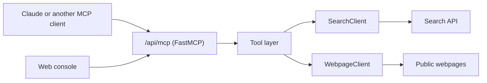

# Ultron: a web search MCP server

[](https://m8ven.ai/mcp/harshit-seth/mcp_server_ultron)

AI assistants can't browse the web on their own. Ultron is a small
[Model Context Protocol](https://modelcontextprotocol.io) server that fixes that
with two tools: one to search the web, one to read a page. It works with Claude
Desktop and any other MCP client, and it ships with a built-in web console so you
can try every tool from your browser before you connect anything.

I wrote it in Python with a security-first approach to fetching pages, since a
tool that fetches arbitrary URLs for an AI is exactly the kind of thing that can
be pointed at your internal network if you aren't careful.

## What it can do

| Capability | What it does |
| --- | --- |
| `web_search` | Searches the web through a Brave-compatible search API. Returns title, URL, snippet and source domain for up to 10 results. |
| `fetch_webpage` | Downloads a public HTML page and returns its readable text, with scripts, styles and other noise removed. |
| `server://info` | A resource describing the server, its version and its tools. |
| Web console | A browser UI at `/` that lists everything above, builds a form for each tool, and shows the raw request and response. |

`fetch_webpage` works out of the box. `web_search` needs a search API key (see
[Configuration](#configuration)). Without one, it tells you so instead of
returning made-up results.

## Quick start

You need Python 3.12+ and [uv](https://docs.astral.sh/uv/).

```bash
git clone https://github.com/harshit-seth/Mcp_Server_ultron.git
cd Mcp_Server_ultron
uv sync
cp .env.example .env        # then add your SEARCH_API_KEY
uv run web-search-mcp
```

Then open **http://127.0.0.1:8080/** to use the console. The MCP endpoint itself
is `http://127.0.0.1:8080/api/mcp`, and a health check lives at `/api/healthz`.

## The console

The console is a single page served by the same process, so there is nothing
extra to install or deploy. When it loads, it asks the server what it offers and
builds the interface from the answer. If you add a new tool later, it shows up
without any frontend changes.

- Every tool, resource and prompt in a list on the left.
- A form for each tool, generated from its input schema, with validation.
- Search results as readable links and fetched pages as text, plus the
  structured JSON.
- The exact JSON-RPC request that was sent and the response that came back.
- A health indicator, a history of recent calls, and a "Copy as curl" button.

## Using it with Claude

**Claude Desktop (local, stdio).** Add this to your Claude Desktop config and
adjust the path:

```json
{
  "mcpServers": {
    "web-search": {
      "command": "uv",
      "args": [
        "run",
        "--directory",
        "/absolute/path/to/Mcp_Server_ultron",
        "web-search-mcp",
        "--transport",
        "stdio"
      ],
      "env": {
        "SEARCH_API_KEY": "your-key-here"
      }
    }
  }
}
```

**Remote (Streamable HTTP).** Deploy the server and add
`https://<your-domain>/api/mcp` as a custom connector in your MCP client. Read
[Before you deploy](#before-you-deploy) first.

## Configuration

Settings come from environment variables or a `.env` file. Only placeholders
belong in `.env.example`, and `.env` is git-ignored.

| Variable | Default | Purpose |
| --- | --- | --- |
| `SEARCH_API_KEY` | none | Search provider key. Required for `web_search` only. |
| `SEARCH_API_URL` | Brave web search endpoint | Any Brave-compatible JSON search endpoint. The key is sent as `X-Subscription-Token`. |
| `PORT` | `8080` | HTTP port. |
| `HOST` | `0.0.0.0` | Bind address. |
| `MCP_TRANSPORT` | `streamable-http` | `streamable-http`, `sse` or `stdio`. |
| `REQUEST_TIMEOUT_SECONDS` | `15` | Timeout for outbound requests. |
| `MAX_FETCH_BYTES` | `2000000` | Largest page the server will download. |
| `MAX_RESPONSE_CHARS` | `20000` | Longest text returned from a page. |
| `MAX_REDIRECTS` | `3` | Redirects followed when fetching a page. |

## How it works



Tools stay thin: they validate input and hand off to a service client. The clients
do the network work and turn failures into short, safe error messages that never
include credentials, headers or stack traces.

```text
src/web_search_mcp/
├── server.py            entry point, routes, console
├── config.py            validated settings
├── errors.py            safe, user-facing errors
├── models.py            response models
├── services/            search_client.py, webpage_client.py
├── tools/               search.py, webpage.py
├── utils/               validation.py (SSRF checks), extraction.py
└── static/index.html    the web console
tests/                   19 tests, no network required
```

## Security

What is in place today:

- Only `http` and `https` URLs are accepted, and URLs with embedded credentials are rejected.
- Hostnames are resolved and rejected if any address is loopback, private,
  link-local, multicast, reserved or unspecified.
- Redirects are followed manually, up to a limit, and every hop is validated again.
- Downloads and returned text are size-capped, and only HTML responses are read.
- The API key is read from the environment and sent only to the search endpoint.
- The console builds the page with `textContent` only, so content from fetched
  pages can't inject markup, and it is served with a restrictive
  Content-Security-Policy.

### Before you deploy

Being upfront about the gaps:

1. **There is no authentication.** Anyone who can reach `/api/mcp` can use your
   search quota and use the server to fetch pages. Put it behind a token or a
   private network before exposing it. A bearer-token check is the next item on
   the roadmap.
2. **The private-network check has a DNS rebinding gap.** The hostname is
   validated, then resolved again when the connection is made. A hostile DNS
   server could answer differently the second time. Fixing this means connecting
   to the already-validated IP address.
3. **The DNS lookup is blocking.** It runs on the event loop, so a slow lookup can
   briefly stall other requests.
4. **Static HTML only.** Pages rendered by JavaScript and non-HTML files such as
   PDFs aren't supported.

## Development

```bash
uv run pytest            # 19 tests, fully offline
uv run ruff check .      # lint
```

The tests mock both the HTTP layer and DNS, so they run without internet access
or an API key.

## Deploying on Replit

1. Add `SEARCH_API_KEY` as a Replit Secret.
2. Run `uv run web-search-mcp --transport streamable-http`. The server binds
   `0.0.0.0` and reads `PORT` from the environment.
3. Check `https://<your-domain>/api/healthz`, then use the console at `/` (or
   `/api/ui` if only `/api/*` is routed to the service) and the MCP endpoint at
   `/api/mcp`.

## Roadmap

- [ ] Bearer-token authentication
- [ ] Connect to the validated IP to close the DNS rebinding gap
- [ ] Non-blocking DNS resolution
- [ ] Short-lived result caching
- [ ] Adapters for other search providers

## Author

Built by Harshit Seth ([@harshit-seth](https://github.com/harshit-seth)).
